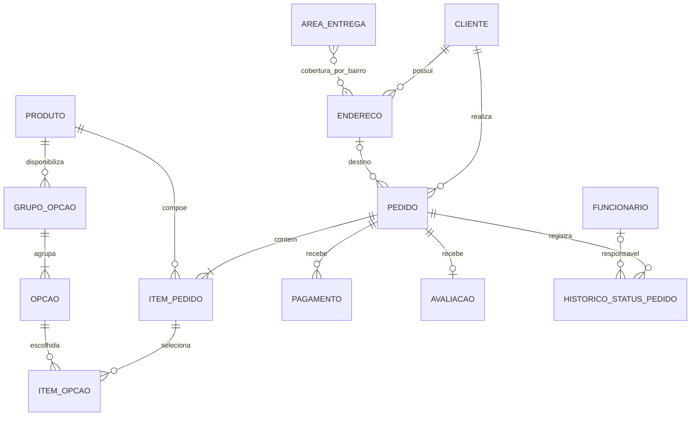

# DeliveryFácil — Modelagem e Dicionário de Dados

## Modelo conceitual (DER)

A relação `ITEM_PEDIDO` x `OPCAO` é N:N e é resolvida pela entidade associativa `ITEM_OPCAO`. A tabela associativa registra o preço adicional congelado no pedido.

## Modelo lógico resumido

- CLIENTE(**id_cliente**, nome, telefone [UK], email, telefone_verificado, anonimizado, criado_em)
- ENDERECO(**id_endereco**, id_cliente [FK], rua, numero, complemento, bairro, cep, referencia, latitude, longitude, disponivel_entrega)
- AREA_ENTREGA(**id_area**, bairro [UK], taxa_entrega, pedido_minimo, ativo)
- FUNCIONARIO(**id_funcionario**, nome, papel, ativo)
- PRODUTO(**id_produto**, nome, descricao, preco, categoria, foto_url, status, alterado_por [FK], atualizado_em)
- GRUPO_OPCAO(**id_grupo_opcao**, id_produto [FK], nome, obrigatorio, min_selecoes, max_selecoes)
- OPCAO(**id_opcao**, id_grupo_opcao [FK], nome, preco_adicional)
- PEDIDO(**id_pedido**, id_cliente [FK], id_endereco [FK, nulo na retirada], tipo_entrega, data_pedido, status, subtotal_produtos, taxa_entrega, desconto_cupom, valor_total, motivo_cancelamento)
- ITEM_PEDIDO(**id_item**, id_pedido [FK], id_produto [FK], quantidade, preco_unitario, observacao)
- ITEM_OPCAO(**id_item [PK/FK]**, **id_opcao [PK/FK]**, preco_adicional_congelado)
- PAGAMENTO(**id_pagamento**, id_pedido [FK], forma_pagamento, status_pagamento, valor, id_transacao_gateway [UK], criado_em)
- AVALIACAO(**id_avaliacao**, id_pedido [FK/UK], nota, comentario, resposta_restaurante, criada_em)
- HISTORICO_STATUS_PEDIDO(**id_historico**, id_pedido [FK], status_anterior, status_novo, data_alteracao, id_funcionario [FK], observacao)

## Dicionário de dados

Os domínios e tamanhos abaixo correspondem ao DDL SQL Server. `NULL` indica campo opcional.

| Tabela.campo | Tipo SQL Server | Regra |
|---|---|---|
| CLIENTE.id_cliente | INT IDENTITY(1000,10) | PK |
| CLIENTE.nome | VARCHAR(100) | NOT NULL |
| CLIENTE.telefone | VARCHAR(15) | NOT NULL, UNIQUE, somente dígitos |
| CLIENTE.email | VARCHAR(150) | NULL |
| CLIENTE.telefone_verificado | BIT | NOT NULL, DEFAULT 0 |
| CLIENTE.anonimizado | BIT | NOT NULL, DEFAULT 0 |
| CLIENTE.criado_em | DATETIME2(0) | NOT NULL, DEFAULT SYSDATETIME |
| ENDERECO.id_endereco | INT IDENTITY | PK |
| ENDERECO.id_cliente | INT | FK CLIENTE, NOT NULL |
| ENDERECO.rua | VARCHAR(150) | NOT NULL |
| ENDERECO.numero | VARCHAR(10) | NOT NULL |
| ENDERECO.complemento | VARCHAR(100) | NULL |
| ENDERECO.bairro | VARCHAR(100) | NOT NULL |
| ENDERECO.cep | VARCHAR(9) | NOT NULL, formato 00000-000 |
| ENDERECO.referencia | VARCHAR(150) | NULL |
| ENDERECO.latitude / longitude | DECIMAL(9,6) | NOT NULL, CHECK de faixa |
| ENDERECO.disponivel_entrega | BIT | NOT NULL, DEFAULT 0 |
| AREA_ENTREGA.id_area | INT IDENTITY | PK |
| AREA_ENTREGA.bairro | VARCHAR(100) | NOT NULL, UNIQUE |
| AREA_ENTREGA.taxa_entrega | DECIMAL(10,2) | NOT NULL, CHECK >= 0 |
| AREA_ENTREGA.pedido_minimo | DECIMAL(10,2) | NOT NULL, DEFAULT 0 |
| AREA_ENTREGA.ativo | BIT | NOT NULL, DEFAULT 1 |
| FUNCIONARIO.id_funcionario | INT IDENTITY | PK |
| FUNCIONARIO.nome | VARCHAR(100) | NOT NULL |
| FUNCIONARIO.papel | VARCHAR(20) | NOT NULL, CHECK OPERADOR/GESTOR |
| FUNCIONARIO.ativo | BIT | NOT NULL, DEFAULT 1 |
| PRODUTO.id_produto | INT IDENTITY | PK |
| PRODUTO.nome | VARCHAR(100) | NOT NULL |
| PRODUTO.descricao | VARCHAR(500) | NULL |
| PRODUTO.preco | DECIMAL(10,2) | NOT NULL, CHECK > 0 |
| PRODUTO.categoria | VARCHAR(50) | NOT NULL |
| PRODUTO.foto_url | VARCHAR(255) | NULL |
| PRODUTO.status | VARCHAR(10) | NOT NULL, DEFAULT ATIVO, CHECK |
| PRODUTO.alterado_por | INT | FK FUNCIONARIO, NULL |
| PRODUTO.atualizado_em | DATETIME2(0) | NOT NULL, DEFAULT SYSDATETIME |
| GRUPO_OPCAO.id_grupo_opcao | INT IDENTITY | PK |
| GRUPO_OPCAO.id_produto | INT | FK PRODUTO, NOT NULL |
| GRUPO_OPCAO.nome | VARCHAR(50) | NOT NULL |
| GRUPO_OPCAO.obrigatorio | BIT | NOT NULL, DEFAULT 0 |
| GRUPO_OPCAO.min_selecoes / max_selecoes | INT | NOT NULL, CHECK min <= max |
| OPCAO.id_opcao | INT IDENTITY | PK |
| OPCAO.id_grupo_opcao | INT | FK GRUPO_OPCAO, NOT NULL |
| OPCAO.nome | VARCHAR(50) | NOT NULL |
| OPCAO.preco_adicional | DECIMAL(10,2) | NOT NULL, DEFAULT 0, CHECK >= 0 |
| PEDIDO.id_pedido | INT IDENTITY | PK |
| PEDIDO.id_cliente | INT | FK CLIENTE, NOT NULL |
| PEDIDO.id_endereco | INT | FK ENDERECO, NULL para retirada |
| PEDIDO.tipo_entrega | VARCHAR(10) | NOT NULL, CHECK ENTREGA/RETIRADA |
| PEDIDO.data_pedido | DATETIME2(0) | NOT NULL, DEFAULT SYSDATETIME |
| PEDIDO.status | VARCHAR(30) | NOT NULL, DEFAULT PENDENTE, CHECK |
| PEDIDO.subtotal_produtos / taxa_entrega / desconto_cupom / valor_total | DECIMAL(10,2) | NOT NULL, DEFAULT 0 |
| PEDIDO.motivo_cancelamento | VARCHAR(250) | NULL |
| ITEM_PEDIDO.id_item | INT IDENTITY | PK |
| ITEM_PEDIDO.id_pedido | INT | FK PEDIDO, NOT NULL |
| ITEM_PEDIDO.id_produto | INT | FK PRODUTO, NOT NULL |
| ITEM_PEDIDO.quantidade | INT | NOT NULL, CHECK > 0 |
| ITEM_PEDIDO.preco_unitario | DECIMAL(10,2) | NOT NULL, CHECK > 0 |
| ITEM_PEDIDO.observacao | VARCHAR(200) | NULL |
| ITEM_OPCAO.id_item / id_opcao | INT | PK composta e FKs |
| ITEM_OPCAO.preco_adicional_congelado | DECIMAL(10,2) | NOT NULL, DEFAULT 0 |
| PAGAMENTO.id_pagamento | INT IDENTITY | PK |
| PAGAMENTO.id_pedido | INT | FK PEDIDO, NOT NULL |
| PAGAMENTO.forma_pagamento | VARCHAR(10) | NOT NULL, CHECK PIX/CARTAO |
| PAGAMENTO.status_pagamento | VARCHAR(12) | NOT NULL, DEFAULT AGUARDANDO, CHECK |
| PAGAMENTO.valor | DECIMAL(10,2) | NOT NULL, CHECK > 0 |
| PAGAMENTO.id_transacao_gateway | VARCHAR(100) | NULL, UNIQUE |
| PAGAMENTO.criado_em | DATETIME2(0) | NOT NULL, DEFAULT SYSDATETIME |
| AVALIACAO.id_avaliacao | INT IDENTITY | PK |
| AVALIACAO.id_pedido | INT | FK e UNIQUE, NOT NULL |
| AVALIACAO.nota | TINYINT | NOT NULL, CHECK 1 a 5 |
| AVALIACAO.comentario / resposta_restaurante | VARCHAR(1000) | NULL |
| AVALIACAO.criada_em | DATETIME2(0) | NOT NULL, DEFAULT SYSDATETIME |
| HISTORICO_STATUS_PEDIDO.id_historico | INT IDENTITY | PK |
| HISTORICO_STATUS_PEDIDO.id_pedido | INT | FK PEDIDO, NOT NULL |
| HISTORICO_STATUS_PEDIDO.status_anterior / status_novo | VARCHAR(30) | status_novo NOT NULL |
| HISTORICO_STATUS_PEDIDO.data_alteracao | DATETIME2(0) | NOT NULL, DEFAULT SYSDATETIME |
| HISTORICO_STATUS_PEDIDO.id_funcionario | INT | FK FUNCIONARIO, NULL |
| HISTORICO_STATUS_PEDIDO.observacao | VARCHAR(250) | NULL |

> Observação: AREA_ENTREGA é consultada pelo bairro do endereço. O relacionamento geográfico é operacional, não uma FK direta, porque a regra de cobertura compara o texto do bairro normalizado.
